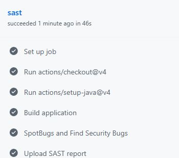
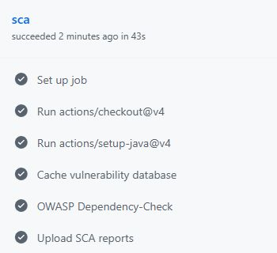

# Защищённый REST API

Приложение на Java 21 и Spring Boot 4.1.2 реализует регистрацию, вход и получение профиля. Данные хранятся в H2, доступ к базе выполняется через Spring Data JPA/Hibernate.

## Запуск

Требуются JDK 21 и Maven 3.9. Команды для PowerShell 7:

```powershell
mvn package
$env:JWT_SECRET = [Convert]::ToBase64String(
  [Security.Cryptography.RandomNumberGenerator]::GetBytes(48))
$env:DB_PASSWORD = [Convert]::ToBase64String(
  [Security.Cryptography.RandomNumberGenerator]::GetBytes(32))
java -jar target/secure-rest-api-1.0.0.jar
```

Адрес: `http://127.0.0.1:8080`. Для повторного открытия базы `data/secure-api` сохраните прежний `DB_PASSWORD`.

## API

**POST /auth/register** — регистрация пользователя, третий метод задания. Тело запроса (сохранить в `register.json`):

```json
{"login":"student","password":"Example-Lab-Password-2026!",
 "displayName":"Student"}
```

Ответ `201` содержит `id`, `login`, `displayName`. Повторный логин даёт `409`, неверные поля — `400`. Пароль должен содержать не менее 12 символов и не более 72 байт UTF-8.

**POST /auth/login** — вход. Тело запроса (сохранить в `login.json`):

```json
{"login":"student","password":"Example-Lab-Password-2026!"}
```

При успешном входе ответ `200` содержит `accessToken`, `tokenType: Bearer`, `expiresIn: 900`. Неверный логин или пароль приводит к `401`.

**GET /api/data** — профиль текущего пользователя. Требуется заголовок `Authorization: Bearer <accessToken>`. Ответ `200` — массив с профилем; без корректного токена возвращается `401`.

## Меры защиты

**SQLi.** Методы `findByLogin` и `findById` в Spring Data JPA используют параметризованные запросы. Пользовательский ввод не добавляется в SQL конкатенацией и не меняет структуру запроса.

**XSS.** Строки пользователя перед выдачей в JSON экранируются через `HtmlUtils.htmlEscape`. Например, `<script>alert(1)</script>` возвращается как `&lt;script&gt;alert(1)&lt;/script&gt;`.

**Пароли.** В базе хранится результат `BCryptPasswordEncoder(12)` со случайной солью. При входе пароль проверяется методом `matches`; пароль и хэш не возвращаются клиенту.

**JWT.** После успешного входа сервер выдаёт токен HS256 на 15 минут. Фильтр Spring Security проверяет подпись, срок действия, издателя и аудиторию до вызова защищённого метода. Профиль выбирается по идентификатору пользователя в `sub`. Ключ подписи передаётся через `JWT_SECRET`.

## Проверка через curl

Используйте сохранённые выше JSON-файлы. Пример команд для Bash:

```bash
curl -i -H 'Content-Type: application/json' \
  --data-binary @register.json http://127.0.0.1:8080/auth/register
curl -i -H 'Content-Type: application/json' \
  --data-binary @login.json http://127.0.0.1:8080/auth/login
curl -i http://127.0.0.1:8080/api/data
curl -i -H "Authorization: Bearer $TOKEN" \
  http://127.0.0.1:8080/api/data
```

В `TOKEN` подставьте `accessToken` из ответа входа. Получены ожидаемые ответы: регистрация — `201`, вход — `200`, доступ без токена — `401`, доступ с токеном — `200`.

## SAST и SCA в GitHub Actions

Workflow `.github/workflows/ci.yml` запускается при каждом push и pull request. Задание `sast` собирает приложение и выполняет SpotBugs с Find Security Bugs. Задание `sca` запускает OWASP Dependency-Check и завершает сборку ошибкой при CVSS ≥ 7. XML-отчёт SAST и HTML/JSON-отчёты SCA сохраняются в артефактах запуска.

[Запуски pipeline](https://github.com/aeshabb/ib-lab1-secure-api/actions/workflows/ci.yml).

[Контрольный запуск](https://github.com/aeshabb/ib-lab1-secure-api/actions/runs/40777368338) завершился успешно: SAST — 0 замечаний, SCA — 49 зависимостей и 0 найденных уязвимостей.



